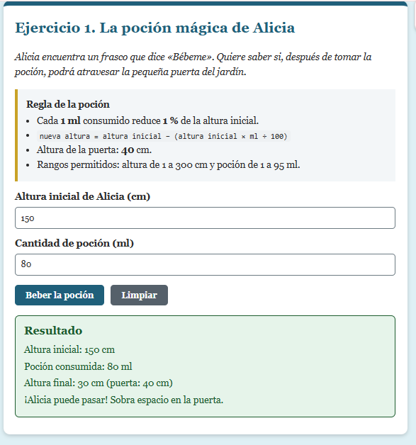
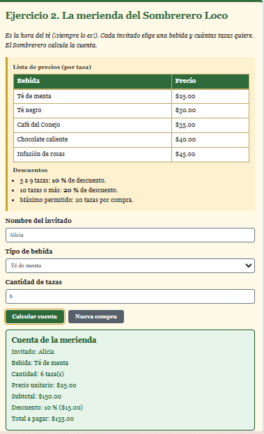
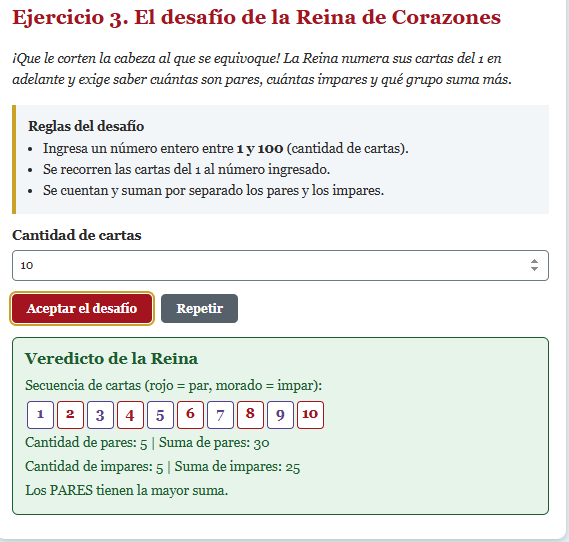

# Alicia en el país de las maravillas — Actividad práctica

**Programación Web I · Formularios HTML, CSS y JavaScript básico**

Página web con tres ejercicios interactivos inspirados en la obra, hechos solo con HTML5, CSS3 y JavaScript nativo (sin frameworks ni bibliotecas, sin Flexbox ni CSS Grid).

- **Autor/a:** LUZ_HELEN_CHIRINOS_CHAMBI
- **Página publicada:** TU_ENLACE_DE_GITHUB_PAGES
- **Video explicativo:** https://youtu.be/LWmR8JY24z0?si=bbDaGsG4SmH9tuO7

## Ejercicios
-----------------------------------------------------------------------------------------------
| # | Ejercicio                           | Estructuras                      | Archivo        |
|---|-------------------------------------|----------------------------------|----------------|
| 1 | La poción mágica de Alicia          | secuencial + if / else if / else | js/pocion.js   |
| 2 | La merienda del Sombrerero Loco     | switch + condicional             | js/merienda.js |
| 3 | El desafío de la Reina de Corazones | for + condicional                | js/reina.js    |
-----------------------------------------------------------------------------------------------
## Cómo usarlo

1. Descarga o clona el repositorio.
2. Abre `index.html` en un navegador (Chrome, Edge o Firefox). No necesita instalación.
3. Elige un ejercicio, llena el formulario y pulsa el botón principal.
4. Cambia los valores y envía de nuevo, o usa el botón Limpiar, para repetir sin recargar la página.

## Estructura del proyecto

```
alicia-web/
├── index.html
├── css/estilos.css
├── js/pocion.js
├── js/merienda.js
├── js/reina.js
├── evidencias/        (capturas de pantalla)
└── README.md
```

## Reglas de cada ejercicio

- **Ejercicio 1:** cada 1 ml de poción reduce 1 % de la altura. Fórmula: nueva altura = altura − (altura × ml ÷ 100). La puerta mide 40 cm. Rangos: altura de 1 a 300 cm y poción de 1 a 95 ml.
- **Ejercicio 2:** precios por taza: té de menta $25, té negro $30, café $35, chocolate $40, infusión de rosas $45. Descuento: 5 a 9 tazas = 10 %, 10 o más = 20 %. Máximo 20 tazas.
- **Ejercicio 3:** cantidad de cartas entera entre 1 y 100. Se recorre del 1 al número con un `for` y se comparan las sumas de pares e impares.

## Casos de prueba

### Ejercicio 1
-----------------------------------------------------------------------------------------------------------------------
| # | Entrada (altura, poción) | Resultado esperado         | Resultado obtenido                                      |
|---|--------------------------|----------------------------|---------------------------------------------------------|
| 1 | 150, 80                  | 30 cm, puede pasar         |¡Alicia puede pasar! Sobra espacio en la puerta.         |
| 2 | 150, 50                  | 75 cm, no puede pasar      |Sigue siendo más alta que la puerta; necesita más poción.|
| 3 | 200, 80                  | 40 cm, puede pasar justo   | Mide exactamente lo mismo que la puerta.                |
| 4 | -10, 50                  | Error: altura positiva     |La altura debe ser un número positivo (mayor que 0).     |
| 5 | 150, 96                  | Error: poción entre 1 y 95 |La poción debe estar entre 1 y 95 ml                     |
-----------------------------------------------------------------------------------------------------------------------
### Ejercicio 2
----------------------------------------------------------------------------------------------------------------------
| # | Entrada (nombre, bebida, tazas) | Resultado esperado           | Resultado obtenido                            |
|---|---------------------------------|------------------------------|-----------------------------------------------|
| 1 | Alicia, té de menta, 1          | Total $25.00, sin descuento  |Total a pagar: $25.00 Descuento: 0 % ($0.00)   |
| 2 | Liebre, café, 5                 | Total $157.50 (10 %)         |Total a pagar: $157.50 Descuento: 10 % ($17.50)|
| 3 | Gato, rosas, 10                 | Total $360.00 (20 %)         |Total a pagar: $360.00 Descuento: 20 % ($90.00)|
| 4 | (vacío), té de menta, 2         | Error: nombre vacío          |El nombre del invitado no puede estar vacío    |
| 5 | Alicia, té de menta, 2.5        | Error: debe ser entero       |La cantidad de tazas debe ser un número entero |
----------------------------------------------------------------------------------------------------------------------
### Ejercicio 3
--------------------------------------------------------------------------------------------------------------------
| # | Entrada (cartas) | Resultado esperado                  | Resultado obtenido                                  |     
|---|------------------|-------------------------------------|-----------------------------------------------------|
| 1 | 1                | Gana impares (suma 1 contra 0)      |Los IMPARES tienen la mayor suma                     |
| 2 | 10               | Pares 30, impares 25: ganan pares   |Los PARES tienen la mayor suma.                      |   
| 3 | 15               | Pares 56, impares 64: ganan impares |Los IMPARES tienen la mayor suma.                    |  
| 4 | 0                | Error: debe ser positivo            |La cantidad de cartas debe ser positiva (al menos 1).| 
| 5 | 101              | Error: máximo 100                   |El máximo es 100 cartas.                             |
--------------------------------------------------------------------------------------------------------------------

## Capturas de pantalla



